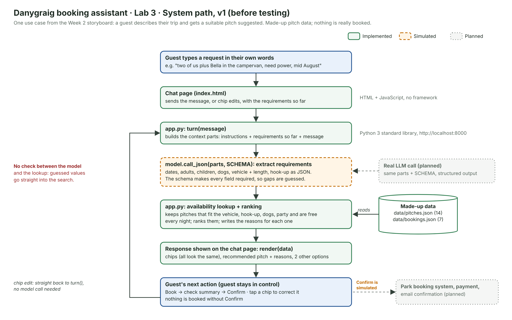

# 01_SPEC.md: use case and system path

**Use case (from my Week 2 storyboard):** a guest describes their trip to the Danygraig booking assistant in their own words and gets a suitable touring pitch suggested, with the chance to check and correct what the assistant understood before anything is booked. The pitch data is made up and Alex and Bella are placeholder names.

**Route:** a small prototype (Python + one web page). Run `python app.py` and open <http://localhost:8000>. `python tests/run_tests.py` replays the test conversations and writes what happened to `tests/results/`.

**Implemented / simulated / planned:** the web page, the turn logic, the availability lookup, the ranking and the chip edits are **implemented**. The language-model step (`model.py`) is **simulated** by a rule-based extractor with the same interface as an LLM call, so the tests replay exactly. The booking itself is **simulated** (nothing is booked). A real LLM call, the park's booking system, payment and email confirmation are **planned**.

## User goal
Alex wants a pitch that suits who is coming (two adults and their dog), their vehicle (a 6 m campervan), their dates and their need for electric hook-up, without filling in a long form, and wants to be sure the assistant has understood before booking.

## System inputs
- **From the guest:** a free-text message such as "Hi, 2 adults, 6m campervan, 14-16 Aug, need electric hook-up", later messages, and edits made by tapping a chip.
- **Context sent with each turn** (the `parts` list in `app.py`): the instructions for the model, the requirements understood so far (the page keeps them and sends them back each turn) and the new message.
- **Data the system reads:** `data/pitches.json` (14 made-up pitches: area, surface, longest vehicle, hook-up, dogs allowed, maximum guests, price a night) and `data/bookings.json` (7 made-up bookings in the 2027 season).

## Processing and technology
| Step | What happens | Technology | Status |
|---|---|---|---|
| 1 | The page sends the message (or chip edits) and the requirements so far | `index.html` (HTML + JavaScript) → `POST /api/turn` | Implemented |
| 2 | Build the context `parts`: instructions + requirements so far + message | `app.py` `turn(message)`, Python 3 standard library server on port 8000 | Implemented |
| 3 | Extract the booking requirements as JSON: dates, adults, children, dogs, vehicle and length, hook-up, and whether the request is out of scope | `model.call_json(parts, SCHEMA)` | **Simulated**: rule-based stand-in for an LLM with structured output (a real LLM is planned) |
| 4 | Find pitches that fit the vehicle, hook-up, dogs and party and are free every night; rank them (dog-friendly pitches kept for dog owners, hardstanding for vans, closest fit, then price) and write the reasons | `app.py` `find_pitches()` and `pitch_card()` with `data/*.json` | Implemented (made-up data) |
| 5 | Show what it understood as chips, one recommended pitch with reasons and two other options | `index.html` `render(data)` | Implemented |
| 6 | Book → check the summary → Confirm | `index.html` | **Simulated**: nothing is booked (booking system, payment and email are planned) |
| 7 | A chip edit updates the requirements and steps 4–5 run again, with no model call | `app.py` `apply_edits()` | Implemented |

## Intended result and next action
The page shows "Here's what I understood. Tap anything that's wrong." with chips (dates and nights, adults, vehicle and length, hook-up, pets), then one recommended pitch with its reasons ("fits your 6 m campervan (takes up to 8 m)", "has electric hook-up", "free 14–16 Aug (2 nights)") and the total price, plus two other options. The guest can **Book** (a summary appears and nothing happens until they press **Confirm**), tap a chip to correct it, or open the other options. The assistant never books on its own.

## Fallback strategy
- **Out of scope** (for example "Can you book me a table at the pub?"): it says what it can help with and points to reception. *(implemented)*
- **Data unavailable** (the pitch or booking file can't be read): it says it can't check which pitches are free and won't suggest one. *(implemented)*
- **No pitch fits:** it says so and lists the closest pitches, each with the one thing that rules it out (for example "Pitch 8: it's booked 15–19 Aug"). *(implemented)*
- **The page can't reach the server:** it says so instead of guessing. *(implemented)*
- **Missing or ambiguous information:** v1 fills it in with a guess. Test B shows why that is a problem; see Review and revision.

## System path or interaction diagram

`diagrams/system_path_v1.png` (source: `system_path_v1.svg`). Solid green = implemented, orange dashed = simulated, grey dotted = planned.

## Test A: standard input
Input: "Hi, 2 adults, 6m campervan, 14-16 Aug, need electric hook-up" (Alex in my Week 2 normal storyboard).

What the system receives: the instructions and the message (no earlier requirements), plus the two data files.

What it does: the simulated model step returns `check_in 2027-08-14, check_out 2027-08-16, adults 2, children 0, dogs 0, campervan, 6.0 m, hookup true`. The lookup checks 14 pitches. It rules out Pitches 1 and 13 (no hook-up), 2, 6, 8 and 9 (booked on those nights), 4 (tents only) and 10 (takes up to 5.5 m). It ranks the rest: Pitch 7, 3, 5, then the dog-friendly 12, 14 and 11, which it keeps for guests with dogs.

Response and next action: chips `14–16 Aug (2 nights)` `2 adults` `campervan 6 m` `hook-up` `pets: none`, and **Pitch 7, Riverside (hardstanding)**: fits your 6 m campervan (takes up to 8 m), has electric hook-up, no-dogs area, free 14–16 Aug (2 nights), £29 a night, £58 in total. Two other options: Pitches 3 and 5. Alex can Book (summary, then Confirm), change a chip or look at the other options. This matches the storyboard. Evidence: `tests/results/test_A_v1.md`, `screenshots/v1_test_A.png`.

## Test B: problem input
Input: "hi, two of us plus Bella in the campervan, need power, mid August". The dates are vague, the van's length is missing, and Bella is the dog, as in my Week 2 failure storyboard.

What the system receives: the same instructions and the message, plus the data files.

What it does: the schema requires every field, so the simulated model step fills each gap with a guess:
- `check_in 2027-08-15, check_out 2027-08-17`: "mid August" became the 15th, plus a default of 2 nights;
- `adults 3`: Bella was counted as a person;
- `dogs 0`;
- `vehicle_length_m 6.0`: the typical campervan length.

Nothing checks these values before the lookup, which returns Pitch 3 first.

Response and next action: the chips `15–17 Aug (2 nights)` `3 adults` `campervan 6 m` `hook-up` `pets: none` all look equally certain. It recommends **Pitch 3, Orchard (grass)**: "quiet, no-dogs area", free 15–17 Aug, £50 in total. The guest could book a no-dogs pitch for dates they never chose. If they notice and tap the chips (`pets: none → 1 dog`, `3 adults → 2`), it says "Pitch 3 doesn't work any more (dogs aren't allowed there)" and offers **Pitch 12** (dog-friendly). But the guessed dates 15–17 Aug stay, and nothing shows they were a guess. Evidence: `tests/results/test_B_v1.md`, `screenshots/v1_test_B.png`.

## Review and revision

### Phase 3: review of v1
| Question | Evidence | Problem found |
|---|---|---|
| Did it make clear what it can and cannot do? | The opening message gives the scope (2027 touring and tent pitches, no payments, no real booking). Out-of-scope test: "Sorry, I can only help you choose a touring or tent pitch… please contact reception" (`tests/results/out_of_scope_v1.md`) | Mostly yes |
| Did it show what it understood? | Test B: the chips appear before anything is booked | Only partly. Guessed values look exactly like stated ones: `15–17 Aug` and `3 adults` look as certain as `hook-up`, so Alex can't tell what to check |
| Could the person correct a wrong extraction? | Test B turn 2: two chip edits lead to Pitch 12 | Yes, one tap per chip, but only if they notice. The guessed dates stayed wrong |
| Did it ask for missing information instead of guessing? | Test B: "mid August" became 15–17 Aug, "plus Bella" became 3 adults, and no length became 6 m | **No.** This is the main problem. The schema needs a value in every field, so the model step guesses, and nothing between the model and the lookup checks the result |
| Did it keep the person in control of the next action? | Book shows a summary and nothing happens until Confirm; the assistant never books by itself | Yes |
| Did it respond honestly when a data source was unavailable? | `tests/results/data_unavailable_v1.md`: "I can't check which pitches are free right now, so I won't suggest one." | Yes |

**Problem chosen:** the assistant guesses missing or ambiguous details and shows the guesses as facts.
- **Interaction side:** it never asks, and it doesn't distinguish stated values from guessed ones.
- **System side:** the extraction schema can't say "unknown", and nothing checks the requirements before the search.
